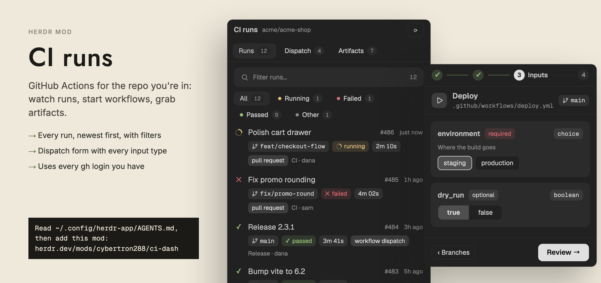

# CI runs

Based on ci-dash-app from [herdr-plugins](https://github.com/dougcunha/herdr-plugins) by dougcunha (Douglas Cunha), MIT licence, copyright (c) 2026 Douglas Cunha. This copy changes the title, the error messages, GitHub login handling, the square panel style and the runs list. The bundled YAML parser keeps its own ISC licence (see Built from).

CI runs shows the GitHub Actions of the repository in the folder you are working in. A header names the repository. Three tabs sit under it: Runs, Dispatch and Artifacts. Runs is one list of the 30 latest runs, newest first, with a search box and filter chips. Click a run to see its jobs and steps. Dispatch starts a workflow by hand in four steps. Artifacts lists build files and downloads them into the repository folder. It follows the focused terminal, so it changes repository when you change folder.



## What you see

The mod fills its block. Colors come from `theme()` by name, so it follows any theme. Examples below use Nightfall: `background` `#212121`, `border` `#2a2a2a`, `foreground` `#c4c4c4`, `muted` `#d6d6d6`, `dim` `#8f8f8f`, `raised` `#2b2b2b`, `hover` `#262626`, `ansi1` `#e06c75`, `ansi2` `#98c379`. Other tokens used (`accent`, `working`, `blocked`, `ansi3`, `solid`) are read from the theme and not fixed here. Base text is 13px.

Frame. Without `panel`: 10px radius and a 1px `border` line on all sides. With `panel: true`: square corners (radius 0) and a 1px `border` line on the top and bottom edges only. Contents are clipped. The frame fills the block (`size_full`).

Header row, 38px high, 12px side padding, 8px gap:
- Title "CI runs", semibold.
- The repository as `owner/repo`, 11px, `dim`, truncated. Empty until a repository is found.
- On the Artifacts tab only: a `↗` button (opens the downloads folder).
- A `⟳` button (refresh).
- Buttons are 26px high, 10px side padding, 7px radius, 12px text, 1px `border` line, `muted` text. A primary or active button uses `accent` for line and text. A disabled button uses `dim` and does nothing.

Tab row, 40px high, 1px `border` line underneath. Each tab is 28px high, 8px radius, 12px text, with a count badge (16px high, 8px radius, 10px text, `dim`):
- Runs, count = number of runs loaded.
- Dispatch, count = number of workflows that can be dispatched.
- Artifacts, count = number of artifacts found.
- The count shows only after that tab has loaded. The active tab has a `raised` fill, a `border` line and `foreground` text. Other tabs use `muted`.

Runs tab:
- Search box, 36px high, 10px radius, `raised` fill, 1px `border` line, a 14px magnifier icon, placeholder "Filter runs…", 12px text. At the right, a count in 11px `dim`: `30`, or `shown/30` when a filter is active. A small close icon (18px target) appears when text is typed and clears it.
- Filter chips under the box, wrapped, 4px gap: All, Running, Failed, Passed, Other. Each chip is 26px high, 8px radius, 12px text, with a 6px colored dot and a count badge. Running uses `working`, Failed `ansi1`, Passed `ansi2`, Other `dim`. Chips other than All show only when they have a count above 0 or are selected. Counts follow the search text. The selected chip has a `raised` fill and a `border` line.
- Run list: one scrolling list, no section headers, sorted by start time (`run_started_at`, else `created_at`) newest first, ties broken by higher run id. Each row has 14px side padding, 8px vertical padding, hover fill `hover`.
  - Top line: status icon (14px), run title (14px, truncated; `display_title`, else `name`, else `Run <id>`), `#<run number>` (11px `dim`), age (11px `dim`: `just now`, `5m ago`, `3h ago`, `2d ago`, then an ISO date after 30 days).
  - Second line, indented 24px, wrapped, 6px gap, made of pills: branch (monospace, 11px branch icon), status pill, duration (`42s`, `3m 07s`, `1h 05m`), event pill in `accent` when the event is not `push` (underscores become spaces), `attempt N` when N is above 1, and `<workflow name> · <actor login>` as 11px `dim` text.
  - Pill: 20px high, 7px side padding, 6px radius, 11px text, 11px icon. Colored pills have a 14% tint of their color (hex alpha `24`) behind text in that color. A plain pill is a 10% wash (alpha `1a`) of `foreground` with `muted` text.
  - Status colors: success `ansi2`, failure `ansi1`, warning `ansi3`, running `working`, queued `blocked`, neutral `dim`. Glyphs: `✓` passed, `✕` failed, `!` warning, `–` neutral, `○` queued. Running shows a spinning 11px (pill) or 14px (row) spinner icon that turns once per 900 ms. Labels: `running`, `passed` (for success), `failed`, `timed out`, `startup failure`, `action required`, `cancelled`, `skipped`, `neutral`, `stale`, or the raw status with underscores as spaces for queued states.
  - If filters match nothing: "No run matches the filters." and a "Clear filters" button.

Run detail (replaces the list when you click a run):
- Top bar with a bottom line: `‹ Runs`, then at the right `Open`, and either `Cancel` (run not finished) or `Rerun` (run finished, primary style).
- Heading block: status icon, run title (15px semibold), `#number`. Under it the status pill, duration, branch, event and attempt pills. Under those, 11px `dim`: `<workflow name> · <actor> · <age>`.
- Jobs: one block per job. The job row is 28px high, semibold, with status icon, name and duration at the right. Steps under it are 22px rows, 12px text, indented 32px, with status icon, name and duration. Finished steps use `muted` text.
- "Waiting for jobs…" shows in `dim` while no jobs exist.
- If an update fails: "Update failed: <message>" in `ansi1`, 11px.
- Artifacts section (only when the run is finished and has artifacts, or listing them failed): header `ARTIFACTS  <count>` followed by artifact rows (same rows as the Artifacts tab). A failed list shows "Could not list artifacts: <message>" in `ansi1`.

Dispatch tab:
- A stepper row with four numbered steps: Workflow, Branch, Inputs, Review. Each is a 20px circle (11px number). The current step is `accent`, done steps show `✓` on a green tint and can be clicked, later steps are `raised` with `dim` text. Steps are joined by 1px lines. When the row is 420px wide or more, every label shows. Narrower, only the current step's label shows.
- Step 1, Workflow: text "Pick a workflow to run by hand.", a filter box ("Filter workflows", count at the right), then one card per workflow. A card has a 10px radius, `raised` fill, a 1px `border` line and 12px padding. It holds a 28px tile with a play icon tinted `accent`, the name (14px), the file path (monospace, 11px, `dim`), and a `›`. A second line has a pill `N input(s)` (accent) or `no inputs`, the latest run's status pill with `last run <age>` (or "no recent run"). While loading: a 22px spinner with "Reading workflows…" and "Checking which ones can be started manually."
- Step 2, Branch: a summary strip with the workflow name and path, a filter box ("Filter branches"), a `BRANCHES` section header ("Choose where the run starts"), then 38px rows with a 14px branch icon (accent for the default branch), the name in monospace, a `default` pill (accent) on the default branch and a `current` pill on the branch of the focused terminal. Order: default branch, current branch, then the rest alphabetical. Footer button `‹ Workflows`.
- Step 3, Inputs: summary strip with the workflow and a branch pill, then one card per input. The card header has the name (13px semibold), a `required` pill (`ansi1`) or `optional` pill, and the type as a monospace pill at the right. A 11px `dim` description follows if there is one. The editor depends on the type: `string`, `number` and `environment` get a 30px text box (8px radius); `boolean` gets a connected `true | false` control (28px high); `choice` gets one 26px chip per option, the chosen one tinted `accent`. Warnings from the workflow file show as banners at the top. A problem message shows as a red banner above the footer. Footer: `‹ Branches` and a primary `Review →`.
- Step 4, Review: summary strip, a banner "Nothing starts until you press Dispatch.", then an `INPUTS` table (key column 110px, monospace, empty values shown as `(empty)`). A workflow with no inputs shows "No inputs to fill" and "The run starts on <branch> with the workflow's own defaults." Footer: `‹ Back` and the primary `Dispatch` button (32px high, 16px side padding, 8px radius, `solid` fill, `solid_foreground` text, 13px semibold, play icon).
- Busy states show a spinner and text such as "Loading branches for <name>…", "Reading <path> at <branch>…", "Dispatching workflow…".
- A notice step shows a banner in `blocked` color and a `‹ Back` button.

Artifacts tab:
- Search box ("Filter artifacts…", count `total` or `shown/total`), a status chip row (All, Available, Downloaded, Expired; Downloaded uses `ansi2`, Expired `ansi1`, Available `accent`), and a type chip row labeled "Type": `All types`, then `.zip`, `.exe` and so on by count, then `other`. The type row shows only when at least one artifact name ends in a known extension. Each chip row counts what the other row already allows.
- Results are grouped by workflow. A group header is the workflow name in capitals, a count, and a dim `#<run number> · <branch>`.
- An artifact row: 15px package icon (`accent`, `dim` when expired), name (14px), and at the right an action word in `accent`: `Download`, `Downloading…`, `Retry`, `Again`. Nothing shows for expired. A second line has pills: file type (monospace, accent), size (`512 B`, `1.5 MB`), age, `expired` (red), `downloaded` with `✓` (green), `failed` with `✕` (red), `downloading` (spinner, `working`). After a download the line also shows the folder path in `dim`, or the error in `ansi1`.
- A line "N workflow(s) could not be read." (11px, `blocked`) shows when some workflows failed.
- Empty states: "No artifacts found." with "None of the latest runs of any workflow produced artifacts."; "No artifact matches the filters." with a "Clear filters" button.

Note line. A one-line strip at the bottom (11px, `blocked`, 1px top line) shows messages like "Cancel…", "Rerun failed: <reason>", `Opened <folder>`.

## How it behaves

Finding the repository:
- Each render checks the focused terminal. It uses the folder of the focused pane, else the focused tab's first folder, else the first folder in the space, else the last folder seen, else the space's folder. When the folder (or machine) changes, it runs `gh repo view` there, resets all tabs and loads runs. If the `repo` prop is set, that repository is used instead.
- The branch shown as "current" in Dispatch is the branch of that terminal.
- While waiting: "Looking for a GitHub repository…".

Polling and notifications:
- A timer runs every 5 seconds. With the list open, it reloads the list quietly only when some run is not finished and the Runs tab is shown.
- With a run open, it reloads that run and its jobs every tick for the first 12 ticks, then every second tick (10 s) up to tick 60, then every sixth tick (30 s). Finished runs are not polled; the display still repaints each tick so ages and running durations stay current.
- When a run changes from not finished to finished, a notification fires: title `CI <label>: <workflow name>`, body `#<number> · <branch> · <duration>`, level `success` for passed, `error` for failed, `info` for the rest. It fires from the list refresh and from the open run.
- When a run finishes in the open detail, its artifacts are listed once.

Runs and detail:
- Click a row to open the run. `‹ Runs` or the Runs tab goes back.
- `Open` opens the run in the browser (`gh run view --web`).
- `Cancel` (only while the run is not finished) posts to the cancel endpoint, then reloads the run.
- `Rerun` (only when finished) posts to the rerun endpoint, clears the artifact list and holds the "queued" look for up to 20 seconds, ignoring the old attempt that GitHub may still return. Polling restarts from tick 0.
- `⟳` reloads what is on screen: the list, the open run (artifacts re-listed), the Dispatch tab (reset and reloaded) or the Artifacts tab.
- Props `filter` and `status` set the search box and chip once, when the repository first loads.

Dispatch:
- Opening the tab reads every workflow once. Only active workflows whose YAML (read from the default branch) declares `workflow_dispatch` are listed, sorted by name, up to 6 read at once. If none qualify, the message names the default branch and says to add `on: workflow_dispatch`.
- Choosing a workflow loads branches (not tags). Choosing a branch reads the workflow file at that branch, and shows an error if it does not declare `workflow_dispatch` there. With no inputs it goes straight to Review. Click a finished step in the stepper to go back. What was loaded stays.
- Defaults: boolean `false`, number `0`, choice the first option when the default is not an option, other types empty.
- Review checks: at most 25 inputs, required inputs not empty, numbers are numbers, choices are in the options. A failure shows a red banner and nothing is sent.
- `Dispatch` first notes the highest existing run id for this workflow, branch and your login, then sends the request. If GitHub returns the new run id, the run opens at once. If not, the mod looks for a run with a higher id, created at most 60 seconds before the request, once per 5 s tick for up to 18 tries (about 90 s). If it cannot find one, it says the workflow was dispatched and was not dispatched a second time. A 401, 403 or 404 while looking gives up with the message.
- When the run is found, the tab switches to Runs, the list reloads and the run opens.
- Props `workflow` (name or path, case-insensitive substring) and `ref` pre-select; `ref` only applies when `workflow` is also set. They stop at the inputs form and never dispatch.

Artifacts:
- Loading scans each workflow in `.github/workflows` (not deleted), checks its latest 5 runs in order and keeps the first run that has artifacts. Groups sort by newest artifact. If every workflow fails, the error shows; otherwise the failed count shows in the note line.
- Click a row to download. An expired artifact shows `Artifact "<name>" has expired.` in the note line instead. A download in progress ignores clicks.
- Files go to `<repository root>/.ci-dash/artifacts/<run id>/<artifact name>/`. The root comes from `git rev-parse --show-toplevel`, else the focused folder. The name is made safe: `<>:"/\|?*` and control characters become `_`, leading dots become `_`, trailing dots and spaces are removed, empty becomes `artifact`.
- After a download the row shows the folder and the action becomes `Again`. A failure shows the message and `Retry`.
- `↗` opens the last download folder, else `.ci-dash/artifacts`, in the system file manager. If neither exists: "No artifacts downloaded yet. They go to <path>".

Error states (shown as a title and a hint in the body):
- Not a git folder: "This folder is not a git repository." / "Focus a terminal inside a repository that has a GitHub remote, and CI runs follows it."
- No GitHub remote: "This repository has no GitHub remote." / "Add one with git remote add origin <url>, or focus a terminal in another repository."
- Repository not visible: "None of your GitHub logins can see this repository." / "Log in with an account that has access: gh auth login, then press ⟳."
- Not logged in: "GitHub CLI is not logged in." / "Run gh auth login in a terminal, then press ⟳."
- No folder: "No folder to look for a repository in."
- `gh` not installed: "Could not start gh: ... Install it from https://cli.github.com and run gh auth login."
- Other GitHub errors show gh's own text with a hint for 401 (log in again), 403 (token needs Actions permission, or the organization needs SSO), 404 (not found or no access) and 429 (rate limit).
- When the folder changes to one with no GitHub repository, the old repository's runs are cleared and the error shows for the new folder.
- Empty and loading: "Loading runs…", "No workflow runs yet." with "Runs appear here after a workflow executes."

## Built from

`mods/ci-dash/mod.json` (the whole file):

```json
{ "place": "none" }
```

It is not placed anywhere on its own. Put it in a layout block, a new tab or a split pane.

Files in `mods/ci-dash/`: `main.js` (the view), `ui.js` (pills, search box, chips, stepper, spinner), `format.js` (time, size, state helpers), `gh.js` (GitHub access), `dispatch.js` (Dispatch tab), `workflow-inputs.js` (reads `workflow_dispatch` inputs), `yaml.js` and `yaml.LICENSE`, and icons `branch.svg`, `ci.svg`, `close.svg`, `info.svg`, `package.svg`, `play.svg`, `search.svg`, `spinner.svg`. Icons are drawn with `svg("mods/ci-dash/<name>.svg")` and tinted by theme color.

Entry: `export default class CiDash extends View` (from `gpui-kit`), using `v_flex`, `h_flex`, `InputState`, `Input` from `gpui-base`. Timer: `cx.timer.every(5000, ...)`. Async work: `cx.spawn`.

Props, read once in `init` (falls back to `props()` if the argument is empty):

| Prop | Meaning |
|---|---|
| `panel` | `true` for a side panel: square, top and bottom borders only |
| `tab` | `runs` (default), `dispatch` or `artifacts` |
| `repo` | pin `owner/repo` instead of following the folder |
| `workflow`, `ref` | pre-select in Dispatch (never dispatches) |
| `filter` | pre-fill the Runs and Artifacts search boxes |
| `status` | pre-select a chip: `live`, `attention`, `passed`, `other` for runs; `available`, `downloaded`, `expired` for artifacts |
| `type` | pre-select an artifact file type, such as `zip` |

Note: `status` values are the group ids from the code (`live`, `attention`, `passed`, `other`; `available`, `downloaded`, `expired`), not the chip labels.

As a side panel:

```json
{ "id": "ci", "type": "block", "content": { "mod": "ci-dash", "props": { "panel": true } } }
```

Or: `herdr-app do tab.new --name CI --mod ci-dash`, or `herdr-app do pane.split --direction right --mod ci-dash`.

`herdr` functions used: `focused()`, `panes()`, `spaces()` (find the folder, machine and branch), `exec(cmd, args, { cwd, on })` (run programs), `home()` (tell Windows from macOS and Linux), `theme()`, `settings()` (`font_family` for monospace text, default `JetBrains Mono`), `notify({ title, body, level })` and `props()`.

Programs run:
- `gh repo view [owner/repo] --json nameWithOwner,url,isPrivate,defaultBranchRef` (find the repository).
- `gh api --hostname <host> --header "Accept: application/vnd.github+json" <path>` for runs, run, jobs, artifacts, workflows, branches, workflow runs and the login (`user`). Lists use `--paginate --slurp`. Cancel and rerun use `--method POST`. Raw workflow files use `Accept: application/vnd.github.raw+json` on the contents endpoint.
- `gh api --method POST ... repos/<owner>/<repo>/actions/workflows/<id>/dispatches -f ref=<branch> -f inputs[<name>]=<value> -F return_run_details=true`. Inputs use `-f` so each stays a string.
- `gh run view <id> --web -R <host>/<owner>/<repo>` (Open).
- `gh run download <id> --name <artifact> --dir <dir> -R <host>/<owner>/<repo>` (download).
- `git rev-parse --show-toplevel` (repository root).
- `gh auth status` and, for the fallback, `sh -c` (see below).
- `test -d <dir>` (macOS and Linux) or `pwsh -NoProfile -Command Test-Path ...` (Windows), then `open` (home starts with `/Users/`), `xdg-open`, or `explorer.exe` to open the downloads folder.

GitHub login fallback (gh.js). `exec` takes no environment, so for a non-active login the mod runs this one-line shell, which reads that login's token for this one call only:

```js
exec("sh", ["-c", 'GH_TOKEN="$(gh auth token -h "$1" -u "$2")" || exit 4; shift 2; GH_TOKEN="$GH_TOKEN" exec gh "$@"', "gh", host, account, ...args], { cwd, on })
```

- `resolveRepo` first runs `gh repo view` as the active login. If the error matches `Could not resolve to a Repository`, `HTTP 404` or `Not Found`, it reads the logged-in accounts from `gh auth status` (lines `Logged in to <host> account <login>` and `Active account: true`). It tries each account that is not active, in order, and keeps the first that can see the repository as `repo.account`. Every later call for that repository uses it. If none can, it throws a 404 error with the first message.
- The active login is never switched and no token is stored.

Files written: only `<repo root>/.ci-dash/artifacts/<run id>/<artifact name>/`, created by `gh run download`. Nothing else is written.

YAML: `yaml.js` is a minified browser bundle of the `yaml` package 2.8.1 that exports only `parse`. `workflow-inputs.js` imports it and reads `on.workflow_dispatch.inputs` (types `string`, `choice`, `boolean`, `number`, `environment`; an unknown type becomes `string`, with a warning). The `yaml` package is ISC licensed, copyright Eemeli Aro; the licence text is in `yaml.LICENSE` and must stay beside `yaml.js`.

## Watch out

- It reaches the network through `gh`. Every GitHub call is a `gh` call from your machine with your login. It runs programs (`gh`, `git`, `sh`, `test`, `open` or `xdg-open`). It writes files in the repository folder, under `.ci-dash/artifacts`. It stores no credentials. Add `.ci-dash/` to the repository's `.gitignore`, or the downloads show in `git status`.
- The panel runs `gh` against whichever folder is focused. Focusing a terminal in another repository switches the panel to that repository.
- `Dispatch` and `Rerun` and `Cancel` change real runs on GitHub. They need a token that can write to Actions. Dispatch only starts after the final Dispatch click.
- `exec` stops after 30 seconds. A very large artifact download can time out and shows `Retry`.
- The mod runtime has no `Buffer`. Raw workflow files are fetched as text with the raw media type. Do not ask for base64 contents.
- Read props once in `init` and keep them. `props()` called inside a later callback can answer for another copy of the mod.
- Use `-f` for dispatch inputs, not `-F`, or `"true"` and `"12"` turn into JSON types. `exec` has no stdin, so the request body cannot be piped.
- The multi-login fallback uses `sh`, so it works on macOS and Linux and not on Windows. `gh auth token` must support `-h` and `-u` (a recent `gh`).
- Dispatch lists branches, not tags. Only workflows that declare `workflow_dispatch` on the default branch appear. A branch that removes it shows an error at the Branch step.
- The Runs list shows 30 runs only. Artifacts looks at each workflow's 5 latest runs and shows the first run that has artifacts.
- Mouse only, apart from the text boxes. There are no keyboard shortcuts and no `keys.json`.
- A run that finishes while you watch can notify twice: once from the open run, and again when the list refreshes later, because the list still holds the old state. A fresh build may or may not match this.
- The sort order is by start time, not by state. A running run older than a finished one sits below it. Use the Running chip to see running ones only.
- Do not give the mod a size smaller than about 340px wide. The Dispatch stepper shows only the current label below 420px.
- Run titles, branches and actors come from GitHub. Long text is truncated with an ellipsis, not wrapped.

## Done when

- `herdr-app check mods/ci-dash` passes.
- With a terminal focused in a repository that has Actions runs, the header shows "CI runs" and `owner/repo`, and the Runs tab lists up to 30 runs newest first, with pills for branch, status and duration, and no section headers.
- The Running, Failed, Passed and Other chips narrow the list and their counts add up to the All count. Typing in the search box narrows it further and clears with the close icon.
- With `"panel": true`, the corners are square and only the top and bottom edges have a line. Without it, a 10px radius and a line on all sides.
- Clicking a run shows its jobs, steps and (when finished) artifacts. `Open` opens the browser. `Cancel` shows only for a running run. `Rerun` shows only for a finished one.
- Starting a run while the panel is open and a watched run finishes raises one notification titled `CI <status>: <workflow>`.
- Dispatch lists only workflows with `workflow_dispatch`, then steps through branch, inputs and review. Nothing starts until `Dispatch` is pressed, and then the new run opens in the Runs tab.
- Artifacts lists artifacts grouped by workflow. Clicking one creates `<repo root>/.ci-dash/artifacts/<run id>/<name>/` and the row shows `downloaded`. `↗` opens that folder.
- A terminal in a folder that is not a git repository shows "This folder is not a git repository." A repository with no remote shows "This repository has no GitHub remote."
- With two `gh` logins where only the non-active one can see the repository, the repository loads and `gh auth status` still shows the same active login.

## Files

- `mods/ci-dash/mod.json`
- `mods/ci-dash/main.js`
- `mods/ci-dash/ui.js`
- `mods/ci-dash/format.js`
- `mods/ci-dash/gh.js`
- `mods/ci-dash/dispatch.js`
- `mods/ci-dash/workflow-inputs.js`
- `mods/ci-dash/yaml.js`
- `mods/ci-dash/yaml.LICENSE`
- `mods/ci-dash/branch.svg`, `ci.svg`, `close.svg`, `info.svg`, `package.svg`, `play.svg`, `search.svg`, `spinner.svg`
- `README.md`
- `RECIPE.md`
- `preview.png`
