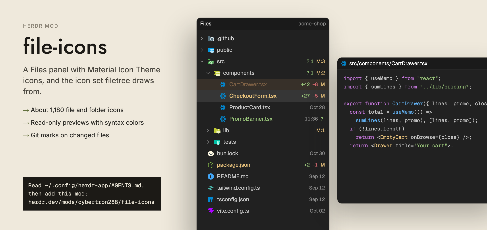

# file-icons

A Files panel for Herdr. It lists the folder of the terminal you are working in, as a tree you open one folder at a time. Every file and folder has a coloured icon from VS Code's Material Icon Theme: a TypeScript file, a `package.json`, a `.github` folder, a `src` folder all look different. Changed files carry a small git letter. Click a file and its text opens in place, with syntax colours. The same icons are the set that the `filetree` mod draws from.



## What you see

One rounded card that fills its block. It has two parts, top to bottom.

- **Card.** Background `theme().background` (Nightfall: `#212121`), 1px border `theme().border` (`#2a2a2a`), corner radius 10px, text `theme().foreground` (`#c4c4c4`), base text 13px. Nothing spills outside the corners.
- **Header.** 42px high, 14px side padding, 8px between items, 1px line under it in `border`. Left: the word "Files" in semibold 13px. Right, pushed to the end, 12px text in `theme().dim` (`#8f8f8f`), cut with an ellipsis when long: the name of the root folder (last path segment of the focused terminal's folder). While a file is open, the right side shows that file's icon (14px) and its path from the root instead, and a "←" (20px wide, `theme().muted`) appears before "Files".
- **Tree** (shown when no file is open). Scrolls vertically with a scrollbar, 6px padding. Each row is 28px high, with 8px left padding plus 18px per level of depth, 8px right padding, 7px gap between items, corner radius 7px. A row holds, left to right:
  - a 12px chevron for folders (right when closed, down when open, tinted `dim`), or an empty 12px space for files so names line up;
  - a 16px icon;
  - the name, 13px, taking the rest of the width, cut with an ellipsis;
  - for changed files only, one letter at 11px: `A` in `theme().ansi2` (green), `D` or `U` in `theme().ansi1` (red), `M` in `theme().blocked`.
  Folders come first, then files; each group is sorted by name with `localeCompare`. The `.git` folder is never listed.
- **Notes under the rows,** 12px `dim`, 8px padding: the error text, "Loading files…" (first load), "No files" (empty folder) or "No folder" (no folder known). When a limit was hit, an 11px line: "File list limited to 500 entries per folder and 5,000 total".
- **Preview** (replaces the tree when a file is open). A read-only code view with line numbers, filling the rest of the card, font size 12 in the user's terminal font (`settings().font_family`). While loading or when it fails, a 12px padded line in `dim` shows the message instead.

Syntax colours come from the theme: keyword `ansi5`, string `ansi2`, comment `dim`, function `ansi4`, type `ansi3`, number `ansi1`, constant `ansi6`. Light themes get the light variants of the icons; dark themes get the normal ones.

## How it behaves

- **Which folder.** The folder of the focused pane (`cwd`). If a terminal block is focused, its `cwd`. Else the active space's folder. On another machine, it lists that machine's folder. When the folder or machine changes, the whole panel resets: open folders close, the preview closes, git marks clear, and it loads again.
- **Open and close folders.** Click a folder row to open it. Its children load then, and appear one level deeper. Click again to close it; this also forgets all open folders below it, so opening it again reloads them.
- **Preview.** Click a file row. The tree is replaced by the file's text. Click "←" in the header to go back; the tree comes back with the same folders open.
  - Text longer than 400,000 characters is cut there and a line `… (file truncated)` is added.
  - A file with a NUL character shows "Binary file · no text preview".
  - A file that vanished shows "This file is no longer available".
  - A read error shows "Cannot preview this file (binary, too large, or unreadable)".
  - The preview does not reload when the file changes on disk. Go back and click again.
- **Language.** The file extension picks the highlighter. These are mapped first: `ts`, `tsx`, `mts`, `cts`, `jsx`, `mjs` to `js`; `toml` to `yaml`; `jsonc` to `json`; `svelte`, `vue` to `html`. Other extensions are used as they are. A name without a dot uses `txt`.
- **Git marks.** After each load it runs git in the folder. In a repo, each changed or untracked file gets a letter: `A` for untracked (`??`) or any status with `A`; else `U` if the status has `U`; else `D` if it has `D`; else `M`. Only files get letters. Folders never do. Outside a repo, nothing is marked.
- **Hover.** A row's background becomes `theme().hover` and the pointer becomes a hand. Nothing else reacts to hover.
- **Keys.** None. The panel handles no keyboard input and has no commands.
- **Refresh.** Every 10 seconds. For a folder on this computer it also refreshes when something under the root changes. For a space on another machine only the 10-second timer runs. A refresh reloads the root and every open folder, and the git marks. Only one refresh runs at a time. A failed load shows its error text under the rows; it clears on the next good refresh.
- **Icons.** See Built from for the rules. The folder icon switches to its "open" variant while the folder is open.

## Built from

**Folder.** `mods/file-icons/`. The mod must live in a folder with exactly this name: the icon paths are the fixed string `mods/file-icons/icons/<id>.svg`, relative to the Herdr home.

**`mod.json`:**

```json
{ "place": "none" }
```

It does not appear anywhere until a layout shows it, for example `{ "id": "files", "type": "block", "content": { "mod": "file-icons" } }`. It takes no props. It is a port of Herdr's own `files` mod (Apache-2.0, https://github.com/herdrdev/herdr-app) with the icons, the 28px rows and the preview-header icon added.

**`main.js`** default-exports `class Files extends View`. Imports:

- `gpui-kit`: `View`, `div`, `svg`, `image`
- `gpui-base`: `v_flex`, `h_flex`, `Editor`, `EditorState`
- `herdr`: `spaces`, `panes`, `focused`, `exec`, `readTextFile`, `watchFolder`, `theme`, `settings`, `window`
- `./icons.js` (default export, the icon tables)

**Herdr calls.**

- `focused()`, `panes()`, `spaces()` find the folder: pane `cwd`, else focused `cwd`, else active space `folder`. The machine is `space.machine`, or the part before `/` in the focused terminal address when a terminal block is focused. `render` compares this against the last one and resets when it changed.
- `exec` runs programs (below). `readTextFile(path, { on })` reads a file for the preview. `watchFolder(root)` loops: await a change, refresh. If it throws, watching stops until the next refresh.
- `theme()` for colours, `settings().font_family`, `settings().dark` (picks light or dark icons), `window().platform` (`"windows"` switches the folder listing).
- `cx.timer.every(10000, …)` for the refresh. `cx.spawn` for async work. No `run` commands.
- Always use the `cx` a callback receives; never keep one.

**Programs it runs (through `exec`, in the user's real environment, on the space's machine when it is remote).**

1. Folder listing, Unix or remote: `sh -c <script> files <path>`. The script loops over `"$1"/*`, `"$1"/.[!.]*`, `"$1"/..?*`, skips `.git`, tells directories from files and symlinks (a symlink counts as a file), prints `kind\0name\0` pairs, stops after 501 entries, and ends with `test -d "$1"` so a missing folder gives a non-zero code. Output is split on `\0`.
2. Folder listing, local Windows: `powershell -NoProfile -Command` with `Get-ChildItem -LiteralPath $p -Force`, drops `.git`, takes the first 501, marks a directory only if it is not a reparse point, and prints compact JSON. A single result is wrapped into an array.
3. `git rev-parse --show-toplevel` in the folder (a failure means "not a repo").
4. `git --no-optional-locks -c core.fsmonitor=false status --porcelain=v1 -z --no-renames --untracked-files=normal`. Each entry is stored under `<toplevel>/<path>`; the row looks up `<root>/<path>`. At most 5,000 entries are read.

**Files it reads.** Directory listings (above), and a file's text when its row is clicked, from `<root>/<path>`. Its own icons and `chevron-*.svg` from `mods/file-icons/`.

**Limits in the code.** `PER_FOLDER = 500`, `TOTAL = 5000` rows across all open folders, depth 40, preview cut at 400,000 characters.

**Layout in code.**

- Card: `v_flex().id("files").size_full().min_h(0).rounded(10).overflow_hidden().bg(background).border_1().border_color(border).text_size(13)`.
- Header: `h_flex().h(42).px(14).gap(8)` with `border_b(1)`.
- Row: `h_flex().id("file-<path>").h(28).flex_none().pl(8 + depth*18).pr(8).gap(7).items_center().rounded(7).cursor_pointer().hover(bg(hover))`.
- Chevron: `svg(...).size(12).text_color(dim)`. Icon: `image(...).size(16)`.
- Tree: `v_flex().id("files-tree").flex_1().min_h(0).overflow_y_scrollbar().p(6)`.
- Preview: `Editor.new(EditorState.new({ language, readonly: true, value, font_family, font_size: 12, syntax }))`, `flex_1().min_h(0)`. The previous state is `release()`d when the file changes.

**`icons.js`.** Generated, not hand-written (first line: `// Generated by tools/build-icons.mjs from material-icon-theme 5.40.0 (MIT). Do not edit.`). It is one `export default` object, about 119 KB on two lines:

```
{ file: "file", folder: "folder",
  fileNames: {…2156}, fileExtensions: {…1391}, folderNames: {…935},
  light: { fileNames: {…179}, fileExtensions: {…32}, folderNames: {…5} } }
```

Keys are lowercase names; values are icon ids, meaning file names in `icons/` without `.svg`. A build script is not part of this folder; generate the tables from the `material-icon-theme` 5.40.0 package's icon definitions and its `light` section (names, extensions, folder names). Every id used must exist in `icons/`. A check found none missing, and every folder id has a `-open` file.

**`icon(path, isDir, isOpen, dark)` rules** (path is relative to the root, lowercased, split on `/`; light themes check `ICONS.light[table]` first, then the normal table):

1. Tables: `folderNames` for directories, `fileNames` for files.
2. Path rule first: try each suffix of the path with at least two segments, longest first (`a/b/.github/workflows`, then `b/.github/workflows`, then `.github/workflows`). A hit wins.
3. Folders: then the folder's own name. If not found, the name with a surrounding `__x__` unwrapped and one leading `.`, `_` or `-` removed (`__tests__` finds `tests`; `.config` finds `config`). Last resort: `ICONS.folder`. When open, the id becomes `<id>-open`, or `<base>-open_light` for ids ending in `_light`.
4. Files: then the full file name (`package.json`, `dockerfile`).
5. Files: then extensions from the longest. For `a.spec.ts` it tries `spec.ts`, then `ts`. Each step is the text after the next dot.
6. Last resort: `ICONS.file`.

**Where the icons come from.** `icons/` has 1,184 SVG files taken from the Material Icon Theme for VS Code (https://github.com/material-extensions/vscode-material-icon-theme), version 5.40.0, MIT licence, copyright (c) 2025 Material Extensions. The licence text is in `LICENSE-material-icon-theme.txt` and must ship with the icons. `chevron-down.svg` and `chevron-right.svg` are Lucide chevrons: 24x24 viewBox, `stroke="currentColor"`, stroke width 2, round caps and joins, paths `m6 9 6 6 6-6` and `m9 18 6-6-6-6`.

**Origin.** The code starts from Herdr's shipped `files` mod (Apache-2.0). `main.js` keeps a header comment saying it was modified from it and what was added.

## Watch out

- **It runs programs.** `sh` (or `powershell` on local Windows) to list folders, and `git` to read status. It runs them on a remote machine when the space is remote.
- **It reads files outside its own folder.** It lists the focused terminal's folder and opens any file you click under it, locally or on the remote machine. It writes nothing. It uses no network and no `fetch`. Its own `icons/` and chevrons are read from its folder.
- **The folder name is fixed.** `const DIR = "mods/file-icons"`. If the folder is renamed, every icon is blank. Change `DIR` too.
- **Install it for `filetree` too.** `filetree` draws from `mods/file-icons/icons/`. Do not leave it out because the panel is not shown.
- **Pass the folder as an argument, not inside the script text.** The Unix listing script reads it as `"$1"` (the args are `["-c", script, "files", path]`). Building the script string from the path would break on spaces and quotes.
- **Symlinks.** A symlink to a folder is listed as a file, so it cannot be opened as a folder.
- **500 and 5,000 are hard caps.** The listing script stops at 501 entries per folder, the code keeps 500, and shows the limit note. Row building stops at 5,000.
- **Marks match full paths.** The key is `<git toplevel>/<path>` against `<root>/<path>`. If the root is not the real path of the repo (for example a symlinked folder), marks will not show. Untracked folders (`dir/` in git's output) never match a row, so they get no mark.
- **Stale guard.** Every async result checks that the folder and machine are still the same (`key()`), and that the folder is still open. Without this, a slow load of the old folder paints over the new one.
- **Avoid refresh loops.** git runs with `--no-optional-locks` and `core.fsmonitor=false` so it does not write under `.git`; writing there would trigger the folder watch, which would refresh again.
- **Watching is local only.** `watchFolder` is not used for remote machines, so changes there show up within 10 seconds. On Linux, `watchFolder` may reject a very large tree; the code then relies on the timer.
- **Cleanup of watch.** If the watch throws, `this.watched` is cleared and the next refresh starts it again.
- **`show(null)` is called without `cx` from the "←" handler;** the code then calls `cx.notify()` itself. Keep that pairing.
- **Preview is one file at a time,** has no search, no editing, no scroll memory.
- **Light icons.** Only 216 light overrides exist (179 file names, 32 extensions, 5 folder names). Everything else uses the same icon in both appearances.

## Done when

1. `herdr-app check mods/file-icons` passes with no errors.
2. `mods/file-icons/` holds `main.js`, `icons.js`, `mod.json` (`{ "place": "none" }`), `chevron-down.svg`, `chevron-right.svg`, `LICENSE-material-icon-theme.txt` and `icons/` with 1,184 `.svg` files.
3. Every id in `icons.js` (including the light table and each folder's `-open` form) has a matching file in `icons/`.
4. Shown as `{ "mod": "file-icons" }` in a layout block, it lists the focused terminal's folder: folders first, `.git` absent, names sorted.
5. A `.ts` file, `package.json`, `.gitignore`, a `src` folder and a `node_modules` folder each get a different, correct Material icon. An unknown name gets the plain `file` icon; an unknown folder gets the plain `folder` icon.
6. Clicking a folder opens it one level deeper (18px more left padding) and switches to the open icon and the down chevron. Clicking again closes it.
7. `a.spec.ts` gets the spec icon (extension `spec.ts` beats `ts`); `.github/workflows` gets its own folder icon.
8. In a git repo, a modified file shows `M`, a new untracked file `A`, a deleted one `D`. Outside a repo, no letters.
9. Clicking a file replaces the tree with its highlighted text; a binary file shows "Binary file · no text preview"; "←" brings the tree back with the same folders open.
10. Changing the focused terminal's folder (`cd` in another pane, or focusing another space) switches the tree to that folder and closes any preview.
11. A folder of more than 500 entries shows 500 and the limit note.
12. Under a light theme, files in the light table use their `_light` icons.
13. `filetree`, when installed, shows these icons.

## Files

- `mods/file-icons/main.js`
- `mods/file-icons/icons.js`
- `mods/file-icons/mod.json`
- `mods/file-icons/chevron-down.svg`
- `mods/file-icons/chevron-right.svg`
- `mods/file-icons/icons/` (1,184 SVG files)
- `mods/file-icons/LICENSE-material-icon-theme.txt`
- `README.md`
- `preview.png`
