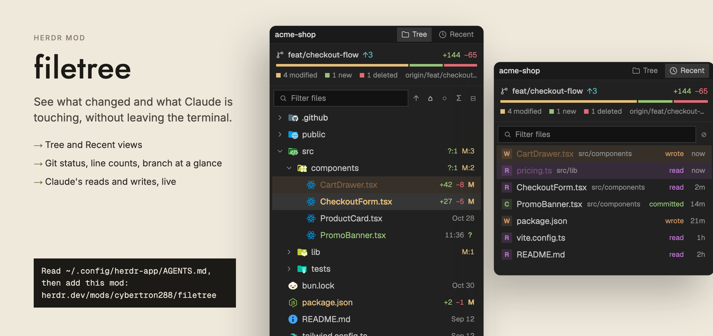

# filetree

An IDE-style file tree for the side panel of any Herdr layout, by cybertron288, based on claude-code-filetree by Kurt Buhler (MIT). It follows the folder of the focused terminal and shows the files in it with git colors, line counts and a branch summary. You can filter across folders you have not opened, preview a file in place, and send a path to your agent. With an optional Claude Code hook, the files Claude reads, writes and commits light up in the tree as it works, and a Recent tab lists them.

## What you see

Top to bottom, in one column that fills its block. Colors are theme tokens from `theme()`; nothing is hard-coded except the ones noted. Corner radius follows the shown layout's pane frame (`pane.radius`, clamped 0 to 6, default 6). Base text is 13px.

1. **Header.** Height from the layout's `pane.header.height`, clamped 26 to 40, default 30. Background `t.chrome`, 1px bottom border `t.border`, 8px side padding, 12px text. On the left, the name of the current folder in `t.muted`, medium weight, truncated. On the right, two tabs, 22px high: **Tree** (folder icon) and **Recent** (clock icon), 11.5px text. The active tab has a `t.selected` background and `t.foreground` text; the other is `t.dim`. A tab shows its label only when it is active or the panel is 300px wide or more; below that it shows the icon alone.
2. **Summary**, 10px side padding, 1px bottom border `t.border`. Three lines:
   - Branch icon (12px) and the branch name in medium 12px `t.foreground`, then `↑N` in `t.ansi6` if ahead and `↓N` if behind (`t.ansi4`), then at the right the total added `+N` (`t.ansi2`) and removed `−N` (`t.ansi1`) lines against HEAD, 11.5px.
   - A 4px-high bar split into segments with 2px gaps and a 3px minimum width each: modified in `t.ansi11` (yellow), new in `t.ansi2` (green), deleted in `t.ansi1` (red), sized by file count. With nothing changed, a flat `t.raised` bar.
   - A legend in 11px `t.dim`: a 7px square swatch and "N modified", "N new", "N deleted"; with nothing changed it reads "clean · nothing to commit". The upstream name (for example `origin/main`) sits right-aligned.
   - Outside a git repository this block is one 28px line: "± no git repo · git status starts after git init".
3. **Filter row**, 6px margin. A 26px-high input with 8px padding: a search icon, the placeholder "Filter files", 12px text, a `×` clear button when it has text. Its border is `t.input` (falls back to `t.border`), and `t.accent` while it has focus. Beside it, 20px-high square tool buttons (12px glyphs, `t.dim`, hover `t.hover`):
   - Tree: `↑` up a folder, `⌂` back to the focused pane's folder, `◉` / `○` show or hide dotfiles, `Σ` dates or sizes, `⊟` collapse all.
   - Recent: `⊘` clear the list.
   A button that is "on" (following, dotfiles shown, sizes shown) uses `t.foreground`.
4. **List.** Virtual list of 26px rows, 4px side padding, a vertical scrollbar over it. Tree row, left to right: left padding 6px plus 14px per level of depth; a 12px chevron (right when closed, down when open; files get a blank 12px slot); a 16px Material Icon Theme icon; the name (13px, truncated); then on the right, in 11px:
   - the date column: time of day (`14:05`) if the file changed today, else `Nov 3`, else `Nov 2025` for another year. It shows only when the panel is wider than 250px and the file has no line counts. With sizes on, it is the size instead (`312 B`, `4.2 K`, `18 M`); folders show `…` until measured.
   - `+N` in `t.ansi2` and `−N` in `t.ansi1` for a changed file; `?:N M:N D:N` chips for a folder (new `t.ansi2`, modified `t.ansi11`, deleted `t.ansi1`).
   - a status letter (10px wide, 11px semibold) in the git color: `M`, `A`, `D`, `R`, `?`, `U`.
   - `⊘` in `t.dim` on a git-ignored file.
   Name colors: git status color if changed (deleted and unmerged `t.ansi1`; new, untracked and added `t.ansi2`; renamed `t.ansi4`; modified `t.ansi11`, falling back to `t.ansi3`), `t.dim` if ignored, `t.muted` for dotfiles, else `t.foreground`. Deleted files are struck through. A symlink name ends in ` ↪`. The selected row has `t.selected` as background and a medium-weight name; others get `t.hover` on hover.
   Recent row: a 16px pill with the letter `R`, `W` or `C`, in a 15% tint of its color; the file name; the folder it is in (11px `t.dim`); the word "read", "wrote" or "committed" in the same color; and the age (`now`, `12s`, `4m`, `3h`, `2d`) right-aligned in a 26px column.
5. **Notes** inside the list area, 12px `t.dim`, at the top: "Loading files…", "Empty folder", "No folder", "Searching…", "No matches", or, in Recent when empty, "Files Claude reads and writes here show up in this list".
6. **Limit lines**, 11px `t.dim`, only when true: "Folders show their first 2000 entries"; "First 200 matches · Enter jumps to the selected one".
7. **Footer**, 24px, 1px top border, 11px. It shows when a row is selected or a git chip is live. Left: the selected path, `t.dim`. Right: Claude's last git action, for example "✓ committed" then the short hash. Running is shown as "pushing…" and pulses; failed is red; otherwise it uses the action's tone.

Preview view (replaces the list and summary): the header shows a back arrow button, the file's icon (14px) and path, then `↗` (open in default app, local only), `⧉` (copy path) and `@` (send to agent). The body is a read-only code view at 12px in the terminal font, or rendered Markdown with selectable text.

Right-click menu: a popup 210px wide, 28px rows, 12.5px text, on `t.popover` (falls back to `t.surface`).

## How it behaves

**Which folder.** The folder of the focused terminal pane (the first terminal in the same tab if a mod pane is focused). It switches when focus moves to another folder. The tree opens folders lazily and remembers, per folder, which subfolders were open and which row was selected. `↑` pins the parent folder and stops following; `⌂` follows again. It works on remote machines too (the same shell commands run there), but the folder watch, "Open in default app", "Reveal" and the `open` command are local only (on a remote machine, double-click always previews).

**Tree view.** Folders first, then files, natural sort, case-insensitive (`file2` before `file10`). `.git` is never listed. Each folder lists at most 2000 entries. Dotfiles show by default; `◉` or `.` toggles. The setting, the date or size choice and the active tab are remembered between sessions.

**Clicks.** Click selects; on a folder it opens or closes it. A second click on the same row within 450ms is a double-click: on a file it opens it (see `open` in config.json). Right-click selects and opens the menu: Preview (files), Open in default app (files, local), Reveal in Finder (or "Show in folder" off macOS; local), Copy relative path, Copy absolute path, Send to agent. Copying shows a 2s toast "Copied". In Recent, clicking a file selects it; clicking a folder or pressing `→` shows it in the Tree tab.

**Keys** (when the list has focus). `j`/`k` or up/down move; PgUp/PgDn move 10; Home/End jump. `l` or right opens a folder; `h` or left closes it, or moves to the parent. Enter opens a file or toggles a folder. Space toggles a folder or previews a file. `p` previews. `y` copies the relative path, `Y` the absolute one. `a` sends `@path ` to the agent. `.` toggles dotfiles. `/` focuses the filter. `1` and `2` switch tab. Esc clears the filter, then the selection. In a preview: Esc, left or `h` goes back; `o` opens it in the default app. In the filter box: up/down move through results, Enter jumps, Esc clears then returns focus to the list.

**Filter.** Typing searches the whole folder, not just open folders, using a one-time index (depth 12, or 5 at the home folder or `/`; skips `.git`, `node_modules`, `target`, `.venv`, `__pycache__`, `dist`, `.next`, plus `Library`, `AppData`, `.Trash` at home; at most 20,000 folders and 40,000 files). Matches by path, file-name hits first, 200 at most, shown as a tree of just the matches and their parents. Enter (or clicking a folder) clears the filter and opens the tree at the chosen file. In Recent, the filter narrows the list instead.

**Preview.** Space, `p`, the menu, or double-click (with `open: "preview"`). Text over 400,000 characters is cut with "… (file truncated)". Binary files say "Binary file · no text preview". Markdown (`.md`, `.markdown`, `.mdx`) is rendered; other files are highlighted by extension (a few mapped: `ts`, `tsx`, `jsx`, `mjs` to js; `toml`, `yml` to yaml; `vue`, `svelte` to html; `sh`, `zsh` to bash). Syntax colors: keyword `t.ansi5`, string `t.ansi2`, comment `t.dim`, function `t.ansi4`, type `t.ansi3`, number `t.ansi1`, constant `t.ansi6`.

**What refreshes and when.** The tree and git status reload every 10s, and at once when the folder watch reports a change (ignoring `.git` itself). Only one reload runs at a time; one more is queued if a change arrives during it. A reload re-lists the root and every open folder, then runs git. Sizes are measured with `du -sk`, two at a time, for visible folders only, while `Σ` is on. The Recent list's ages refresh every 30s while it is shown.

**Claude activity** (needs the hook below; without it everything else works). Reads highlight purple (`t.ansi5`), writes orange (`t.ansi3`), git commits green (`t.ansi2`). On an event the file's row gets a 13% tint of its color, the icon and name pulse (opacity 0.35 to 1 over 900ms) for 2.7s, then the name stays tinted for 45s in total before it fades. A closed folder over a lit file glows in the color during the 2.7s, name only. With `follow` on and the Tree tab shown, the tree opens the parents and scrolls the last lit file to the center (up to 12 files; up to 60 for a search that reads many files). Bash commands that are not read-only are timed: the files the folder watch saw change between start and end are lit orange (ignored files and `.git` skipped). Mentioning `@path` in a prompt selects that file and reveals it. Git actions (commit, push, pull, merge, rebase, stash, reset and so on, `gh pr create` and similar) set the footer chip, running for up to 10 minutes and the result for 45s, and flash the branch row in the action's tone for 2.7s; a commit also lights its files green. Only events whose working folder is inside the shown repo count. Recent keeps the last 120 events (trimmed to 80), newest first, one row per file, kept between sessions.

## Built from

**Files.** `mods/filetree/` and `mods/file-icons/` (icons are loaded from `mods/file-icons/icons/` at runtime, so both folders must be installed).

**mod.json** of filetree: `{ "place": "none", "overlay": { "width": 210, "height": 206 } }`. `place: "none"` means it is put in a layout block by name: `{ "id": "files", "type": "block", "content": { "mod": "filetree" } }`, or opened with `pane.split --mod filetree`. file-icons has `{ "place": "none" }` and is only the icon store (it is also a working Files panel).

**One view, one popup.** `main.js` default-exports a `View`. The same class renders the popup menu when opened with `props().menu` set (via `openOverlay({ mod: "filetree", kind: "popup", width: 210, height: 28 * rows + 10, props: { menu } })`, 7 rows for files, 5 for folders); the menu closes with `closeOverlay(props().overlay)`. No other `props` roles.

**config.json** (read once at start from `<appHome>/mods/filetree/config.json`; an invalid file shows a warning toast and uses defaults):

| Key | Values | Default |
|---|---|---|
| `activity` | `reads and writes`, `writes`, `reads`, `none` | `reads and writes` |
| `follow` | `true` opens folders and scrolls to Claude's activity | `true` |
| `column` | `date` or `size` at start (until the user toggles `Σ`) | `date` |
| `open` | `preview`; `""` for the default app; or a command with `{path}` and `{dir}`, run without a shell, such as `zed {path}` | `preview` |

**Shared state.** Reads `filetree.view` (`{ view: "tree" | "recent", n }`): another mod sets it and the tree switches tab when `n` is new. Reads `filetree.preview` (`{ root, rel, n }`): shows that file if `root` is the shown folder. Writes `filetree.preview` from the Preview menu item (`setShared`). Browser storage keys: `prefs` (`showHidden`, `showSize`, `view`) and `history`.

**herdr imports:** `spaces`, `panes`, `agents`, `focused`, `exec`, `readTextFile`, `watchFolder`, `theme`, `settings`, `window`, `layout`, `home`, `appHome`, `props`, `run`, `notify`, `openOverlay`, `closeOverlay`, `shared`, `setShared`. Commands run: `pane.focus {terminal}` and `terminal.paste` (Send to agent). `layout()` is walked for the first node with `content.tab` and `content.pane` to read `radius` and `header.height`. `settings().font_family` and `settings().dark` set the preview font and the icon set (light themes check the Material light table first).

**gpui-kit and gpui-base:** `View, div, svg, image`; `v_flex, h_flex, Editor, EditorState, InputState, Input, Scrollbar, v_virtual_list, VirtualListScrollHandle, TextView`.

**Programs it runs** (through `exec`):
- `git` in the shown folder, read-only: `git --no-optional-locks -c core.fsmonitor=false -c diff.autoRefreshIndex=false` with `rev-parse --show-toplevel --show-prefix`, `status --porcelain=v1 -z -b --no-renames --untracked-files=normal --ignored=traditional -- .`, `rev-parse --verify -q HEAD`, and `diff HEAD --numstat -z --no-renames -- .`. Ignored paths are capped at 5000.
- `sh -c` scripts: list a folder with one `stat` call (GNU `stat -c '%F/%s/%Y/%n'` or BSD `stat -f '%HT/%z/%m/%N'`), build the search index with `find`, `mkdir -p` the activity folder, `du -sk` for folder sizes.
- `open`, `open -R`, `xdg-open`, `explorer.exe`, or PowerShell `Invoke-Item` to open or reveal a file; the `open` command from config.json if set.
- On Windows (local), PowerShell `Get-ChildItem` replaces the shell scripts for listing and indexing; `du` sizes are off.

**Files read outside its folder:** the project folder being shown (listing, previews), `<home>/.local/state/herdr-filetree/activity.jsonl` (watched with `watchFolder`; each change re-reads the file and takes events newer than the last one seen), and its own `config.json`.

**Optional Claude Code hook, `mods/filetree/bridge.ts`.** A Bun script (`#!/usr/bin/env bun`) run by Claude Code hooks. It reads the hook JSON from stdin and appends one JSON line per event to `~/.local/state/herdr-filetree/activity.jsonl` (`{ at, cwd, session, id, kind, paths, ... }`); when the file passes 256 KB it keeps the last 400 lines. Events: `read` (Read; Grep and Glob with their hit files; paths a read-only Bash command touches: `rg grep find fd cat head tail bat less more ls eza tree wc sed awk jq`), `write` (Write, Edit, MultiEdit, NotebookEdit, on success), `mention` (`@path` in a prompt), `bash-start` and `bash-end` (non-read-only Bash), and `git` (state `running`, `done` or `failed`, with `actions` of verb, label, tone; for a finished commit it also runs `git log -1` and `git show --name-only` to add the hash, subject and files). Git verbs map to tones: commit green, push teal, pull/fetch/checkout/switch/branch/clone blue, merge/rebase/cherry-pick/tag purple, stash/mv orange, add/init green, reset/restore/revert/rm red; `gh` pr create/merge/checkout/comment/review, repo clone, release create and issue create are covered. Read-only git commands are ignored. It always exits 0.

Register it in `~/.claude/settings.json`, merged with any hooks already there (bun is needed, restart Claude Code sessions afterwards). Each entry is `{ "type": "command", "command": "bun \"$HOME/.config/herdr-app/mods/filetree/bridge.ts\"", "timeout": 5 }`:

- `PreToolUse`, matcher `Bash`
- `PostToolUse`, matcher `Read|Grep|Glob|Write|Edit|MultiEdit|NotebookEdit|Bash`
- `PostToolUseFailure`, matcher `Bash`
- `UserPromptSubmit`, no matcher

**Icon art.** 1,180 SVGs in `mods/file-icons/icons/`, picked by `mods/filetree/icons.js` (a generated table, byte-identical to `mods/file-icons/icons.js`, from Material Icon Theme 5.40.0). Matching follows VS Code: lower-case names; a path rule (`.github/workflows`) beats a name, a name beats an extension, the longest extension wins (`spec.ts` over `ts`); open folders use `<id>-open`. Own 12px glyphs in `mods/filetree/`: `chevron-right.svg`, `chevron-down.svg`, `chevron-left.svg`, `folder.svg`, `clock.svg`, `git-branch.svg`, `git-compare.svg`, `search.svg`, `file.svg` (`git-compare` and `file` are not used by the code). Icons are Material Icon Theme by Material Extensions, MIT licence: keep `LICENSE-material-icon-theme.txt` in both folders. The tree is a port of claude-code-filetree (MIT, Kurt Buhler); the hook's command parsing is a trimmed port of its `hooks/git.ts`.

## Watch out

- **It runs programs and reads outside its folder.** It runs `git`, `sh`, `find`, `stat`, `du`, `mkdir`, and `open` or `xdg-open` (PowerShell on Windows), and reads the shown project's files plus `~/.local/state/herdr-filetree/activity.jsonl`. It does not use the network. The git calls are read-only and avoid writing under `.git`; this matters, because a write there would trip the folder watch and loop the refresh. Tell the person before adding it. The hook, if registered, runs `bun` and `git` on every matching Claude tool call.
- **Virtual list rows cannot hold handlers.** `v_virtual_list` gives the list one `on_item_click(rel)` and `on_item_secondary_click(rel)`. Rows only set an `id`. Double-click is built by hand: a second press on the same row inside 450ms.
- **Mods cannot import across folders.** That is why `icons.js` is copied into `mods/filetree/`; keep it identical to the file-icons one. Only the SVGs are read by path (`mods/file-icons/icons/<id>.svg`), so removing file-icons leaves blank icons.
- **No `Intl`.** The runtime has none, so the natural sort is a small hand-written comparer (digit runs compared as numbers) and dates are formatted by hand with a month-name table.
- **`render()` cannot call `cx.notify`.** The `filetree.preview` request is handled inside `render()`, so `show(rel, cx, true)` skips the notify there. Handle `filetree.view` in render the same way, by changing state only.
- **Redraws are throttled.** A one-second timer redraws only when a highlight changes state (bright, tinted, gone), when a chip expires, while sizes are being measured, or every 30s in Recent. Do not redraw every second.
- **Hide `.git` and prune big folders**, or the index and listings grow without bound. Limits: 2000 entries per folder, 200 search hits, 20,000 folders and 40,000 files indexed, 5000 ignored paths, 60 paths per hook event, 400,000 characters of preview, folder nesting 40 deep.
- **Search index is stale-safe only by reset.** It is dropped when the watch sees a change (and no filter is active) and when the folder changes. Typing while it rebuilds uses the newest query only.
- **Folder watch is local only.** Remote folders refresh by the 10s timer; there is no activity highlighting for paths outside the shown folder.
- **Send to agent goes through the clipboard.** It writes `@path ` (quoted if it has spaces; relative to the agent's folder when inside it), focuses the agent's terminal, runs `terminal.paste`, and restores the old clipboard after 600ms. With no agent in the tab it shows a "No agent in this tab" warning toast.
- **Window width matters.** Tab labels need 300px, the date column needs more than 250px. Test narrow (about 220px) and wide (400px).
- **Do not add a Changed tab or a Settings screen**; the code has two views only, Tree and Recent. `1` and `2` are the only tab keys.
- **Colors come from the theme.** Writes are `ansi3` (orange) and modified is `ansi11` (yellow) so they never look alike. Use the theme's `ansi11` and `ansi14` when present, else `ansi3` and `ansi6`.

## Done when

- `herdr-app check mods/filetree` passes (and `herdr-app check mods/file-icons`).
- Put in a layout block, it shows the folder name, the Tree and Recent tabs, a summary line, a filter box with five tool buttons, and a list of rows 26px high with Material Icon Theme icons.
- In a git repo with changes, the summary shows the branch, `+N −N` totals and a colored bar with a legend; changed files show a status letter and line counts in the git colors; folders show `?:N M:N D:N`. Outside a repo it says "no git repo".
- Moving focus to a terminal in another folder changes the tree to that folder.
- Clicking a folder opens it; double-clicking a file opens its preview; Esc goes back. Markdown renders, code is highlighted.
- Typing in the filter finds a file inside an unopened folder; Enter opens the tree at it.
- `Σ` swaps dates for sizes; `.` or `◉` hides dotfiles; both survive a restart.
- Right-click shows the menu with Preview, Copy relative path, Copy absolute path and Send to agent (plus Open and Reveal on a local folder); Send to agent types `@path ` into the tab's agent.
- With the hook registered and Claude reading a file, that row pulses purple and the tree opens to it; a write pulses orange; a `git commit` lights the branch row and files green and shows "✓ committed" with the hash in the footer. Recent lists them with `R`, `W` and `C` pills.
- Setting `"activity": "none"` stops the file highlights; `"open": ""` makes double-click open the default app.
- Without the hook, the mod still works and Recent says "Files Claude reads and writes here show up in this list".

## Files

- `RECIPE.md`: this brief.
- `README.md`: the human install guide.
- `preview.png`: screenshot.
- `mods/filetree/`: `main.js`, `icons.js`, `bridge.ts`, `mod.json`, `config.json`, `chevron-right.svg`, `chevron-down.svg`, `chevron-left.svg`, `folder.svg`, `clock.svg`, `git-branch.svg`, `git-compare.svg`, `search.svg`, `file.svg`, `LICENSE-material-icon-theme.txt`.
- `mods/file-icons/`: `main.js`, `icons.js`, `mod.json`, `chevron-right.svg`, `chevron-down.svg`, `icons/` (1,180 SVGs), `LICENSE-material-icon-theme.txt`.
