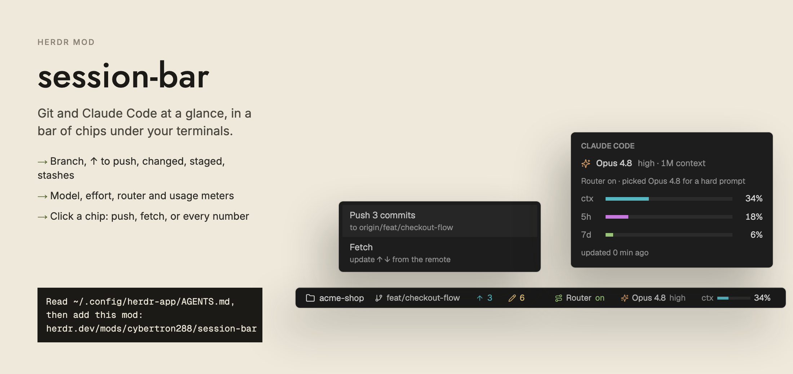

# session-bar

A 28px bar of small chips for the bottom of a Herdr layout. On the left it shows the focused pane's folder and its git state: branch, commits to push and pull, changed, staged and conflicted files, stashes. On the right, while the focused pane runs Claude Code, it shows the Router switch, the model with its effort and context size, and three usage meters: `ctx`, `5h` and `7d`. All colors come from the active theme. The Claude chips need a small Claude Code plugin of the same name, built here too.



## What you see

One row, 28px high, filling its block. Background `t.chrome`, a 1px top border in `t.border`, 14px side padding, 8px gap between chips, text 12px in `t.muted`. Chips are 20px high with 7px side padding, a 5px gap inside, 11.5px text, and an 11px icon. Chip corners follow the shown layout's pane frame `radius` (default 6, clamped to 0 to 6), so a flush layout gets square chips. A flexible spacer splits left from right. Overflow is clipped.

Icons are Lucide SVGs in the mod folder, drawn with `svg()` and tinted by theme color. Example hex values below are from the Nightfall theme (`ansi2` `#98c379`, `ansi1` `#e06c75`, `ansi3` `#d19a66`, `ansi6` `#56b6c2`, `ansi11` `#e5c07b`, `chrome` `#1a1a1a`, `raised` `#2b2b2b`). The mod reads colors by name, so any theme works.

Left, in order. A chip is absent when it has nothing to show.

| Chip | Icon | Color | Shows |
|---|---|---|---|
| folder | `folder` 13px | icon `t.accent`, text inherits `t.muted` | folder name, `~` for home; text max 180px, truncated; tooltip is the full path |
| branch | `git-branch` 11px | icon `t.accent`, text `t.foreground` | branch; text max 260px at 900px wide or more, else 160px; `detached` for a detached HEAD |
| ahead | `arrow-up` | `t.ansi6` (`#56b6c2`) | commits to push |
| behind | `arrow-down` | `t.ansi4` (`#61afef`) | commits to pull |
| changed | `pencil` | `t.ansi11`, else `t.ansi3` | every file from `git status`, untracked included |
| staged | `plus` | `t.ansi2` (`#98c379`) | files with a staged change |
| conflicts | `triangle-alert` | `t.ansi1` (`#e06c75`) | files with merge conflicts |
| stash | `archive` | `t.dim` | stash count |

Right, in order, only for a Claude Code pane:

- Router: `route` icon, the word `Router`, then `on`, `off` or `disabled`. On: icon and word in `t.ansi2`, label in `t.foreground`. Off or disabled: all `t.dim`.
- Model: `sparkles` icon in `t.ansi3`, name in `t.foreground` (`claude-opus-4-8[1m]` becomes `Opus 4.8`), then `t.dim` text with effort and context size, for example `high · 1M`.
- Meters: for each of `ctx`, `5h`, `7d`: a `t.dim` label, a 46x4 track (`t.raised`) with a fill, and `NN%`. Fill color: `ctx` `t.ansi6`, `5h` `t.ansi5`, `7d` `t.ansi2`; at 80% or more `t.ansi3`; at 95% or more `t.ansi1`. A non-zero fill is at least 2px wide.

Widths, measured on the bar itself (it re-measures when the width moves by more than 8px):

- Under 620px: staged and stash chips hide, and the model chip shows only the name.
- 620px up: staged, stash and the effort text show.
- Under 900px: only the `ctx` meter shows, and the context size leaves the model chip.
- 900px up: all meters and the context size show.

Two popup cards, 280px wide, background `t.popover` (else `t.surface`):

- Git menu: rows of 12.5px `t.foreground` text over an 11px `t.dim` subtitle. See How it behaves.
- Claude card: `CLAUDE CODE` caption (10.5px, semibold, `t.dim`). Then a row with a 13px `sparkles` icon, the model name, and `t.dim` text `<effort> · <size> context`. Then the router note (11px, `t.dim`). Then one row per meter: 26px label, a 170x5 track, a right-aligned 34px percent. Last, `updated N min ago` (11px, `t.dim`). It scrolls if the theme's font is large.

## How it behaves

Source of "the focused pane": the focused pane's `cwd`, else the focused terminal's `cwd`, else the active space's folder. For a terminal on another machine, git runs there (`exec` with `on`).

Chip clicks:

- Folder: nothing. Tooltip shows the path.
- Branch: copies the name and shows a "Copied" toast (1.5s). Tooltip names the upstream.
- ↑ ahead: opens the git menu. Rows: `Push N commit(s)` (to the upstream), `Pull N commit(s)` (only if behind), and `Fetch`.
- ↓ behind: opens the same menu. Same rows.
- Changed and conflicts: open filetree's Changed view (below).
- Staged and stash: hover tooltip only.
- Router chip, model chip and each meter: open the Claude card. The router chip does this only when Claude's state file exists.

Menu actions run `git push`, `git pull --ff-only` or `git fetch` in the pane's folder, close the menu, and show an info toast (`Pushing…`, `Pulling…`, `Fetching…`, 1.5s). On exit code 0 a success toast shows the last line of git's output (3s). On failure an error toast shows the output (6s). Menu popup height is 2 rows (Push or Pull, plus Fetch) or 3 rows (both), 44px per row plus 10.

Changed view: the mod writes the shared key `filetree.view` as `{ view: "changed", n: Date.now() }`, then looks for a layout block that shows `filetree`. If it finds one, it selects each stack on the way and shows each node above it. If the layout has none, it splits the pane to the right with the `filetree` mod.

Router states, from the `cc-model-router` plugin:

- No chip: `cc-model-router` has no entry in `enabledPlugins` of `~/.claude/settings.json`.
- `disabled`: the entry is not `true`. Tooltip: "cc-model-router plugin is disabled in Claude Code".
- `on`, no state file for this terminal yet: "cc-model-router is enabled. This session reports its state after it restarts".
- `off`: the session's state file says off. Tooltip: "Router off in this session · /router on turns it on".
- `on`, with a state file: "Router on · picked Opus 4.8 for a high prompt" (the model and tier from the file), or "Router on · picks the model for each prompt" when it has no model. A file marked `ended` is ignored.

Refresh:

- Git status loads when the focused folder or machine changes, and every 8 seconds.
- For a local folder, the mod also watches the repo's top folder with `watchFolder` and reloads on any change. Reloads do not overlap; one queued request runs after the current one.
- The Claude file is re-read when the focused terminal changes, and whenever either state folder changes.
- `~/.claude/settings.json` is re-read every 30 seconds.
- Claude chips, and Claude and router file reads, apply only to a local pane that runs Claude Code. Any other pane clears them. Terminal ids with a `/` (remote) are skipped.

Outside a git repo, the git chips vanish. The branch chip then falls back to the pane's or space's `branch` if Herdr has one.

## Built from

`mods/session-bar/mod.json`:

```json
{ "place": "none" }
```

The layout holds it in a 28px block:

```json
{ "id": "status", "type": "block", "size": { "px": 28 }, "content": { "mod": "session-bar" } }
```

Imports: `View`, `div`, `svg` from `gpui-kit`; `v_flex`, `h_flex` from `gpui-base`; from `herdr`: `spaces`, `panes`, `focused`, `exec`, `readTextFile`, `watchFolder`, `theme`, `home`, `layout`, `props`, `run`, `notify`, `openOverlay`, `closeOverlay`, `setShared`.

Herdr use:

- Commands: `layout.select {stack, child}`, `layout.show {id}`, `pane.split {direction: "right", mod: "filetree"}`.
- Shared key written: `filetree.view`.
- Overlay: `openOverlay({ mod: "session-bar", kind: "popup", width: 280, height, props: { popup } })`. The same class renders the popup when `props().popup` is set, and closes it with `closeOverlay(props().overlay)`.
- `layout()` is walked to find the pane frame `radius` and the `filetree` block.
- Timers: `cx.timer.every(8000)` for git, `cx.timer.every(30000)` for the plugin switch.

Programs it runs (through `exec`, in the pane's folder, on the pane's machine):

```sh
git --no-optional-locks -c core.fsmonitor=false rev-parse --show-toplevel
git --no-optional-locks -c core.fsmonitor=false status --porcelain=v1 -z -b --untracked-files=normal
git --no-optional-locks -c core.fsmonitor=false rev-list --walk-reflogs --count refs/stash
git push | git pull --ff-only | git fetch      # only from the menu
mkdir -p ~/.local/state/herdr-session-bar ~/.local/state/herdr-model-router
```

Counting: a status record starting `##` gives branch, upstream, `ahead N` and `behind N`. Every other record counts as changed. `??` counts as untracked and stops there. Two-letter codes with a `U`, plus `AA` and `DD`, count as conflicts. Others with a non-space first letter count as staged.

Files read outside the mod folder:

- `~/.claude/settings.json` (`enabledPlugins`, key starting `cc-model-router@`).
- `~/.local/state/herdr-session-bar/<terminal>.json` (from the Claude Code plugin below).
- `~/.local/state/herdr-model-router/<terminal>.json` (from the optional `cc-model-router` plugin).

The mod writes none of these. It only creates the two state folders.

Info file shape read from the first: `{ model, effort, window, branch, dirty, meters: [{ label, percent }], isRouted, router, at }`. The router file uses `on`, `model`, `tier`, `ended`.

Art: `folder`, `git-branch`, `arrow-up`, `arrow-down`, `pencil`, `plus`, `triangle-alert`, `archive`, `route`, `sparkles` (Lucide, one `.svg` each in `mods/session-bar/`, loaded as `mods/session-bar/<name>.svg`).

### Claude Code plugin (`claude-plugin/`)

Name `session-bar`, version 0.2.0. Install:

```sh
claude plugin marketplace add cybertron288/herdr-mods
claude plugin install session-bar@herdr-mods
```

- `.claude-plugin/plugin.json`: `name`, `version`, `description`, `types: ./types/index.d.ts`, and one `userConfig` option, `promptLine` (boolean, title "Line under the prompt", default `false`).
- `hooks/hooks.json`: `{ "modules": ["./register.tsx"] }`.
- `hooks/register.tsx`: exports `register`, handling these events: `session.start`, `turn.start` (skipped when the event has an `agentId`), `turn.complete`, `session.measure`, each of which runs a refresh after the next handler; `turn.step` records the effort of the latest request; `ui.render` for `PromptHint`, which draws the optional line.
- `types/index.d.ts`: the `Info` and `Meter` types. `tsconfig.json` is for the editor only.

A refresh reads the session model, usage (context percent and window, plus rate limits), the branch (`git branch --show-current`), whether `git status --porcelain` is non-empty, and the router state through `$.state.get({ plugin: "cc-model-router", key: "router" })`. It tolerates that plugin being absent. Meter labels: `ctx` for context; a kind with "five" becomes `5h`; "seven" or "week" becomes `7d`; others keep their name with `_` as a space. Percents are rounded and clamped to 0 to 100.

Effort shown, first that exists: the router's effort, the latest request's effort, the `/config` row whose key or label matches `effort`, the previous shown value, `effortLevel` in `~/.claude/settings.json`. The model shown is the router's pick when the router has one.

Where it writes: it runs `sh -c 'printf "%s\n%s" "$HC_TERMINAL_ID" "$HOME"'` once to read `HC_TERMINAL_ID`. If that id matches `^[\w.-]+$` and `$HOME` exists, it writes `{ ...info, at: Date.now() }` to `$HOME/.local/state/herdr-session-bar/<terminal>.json`. With no `HC_TERMINAL_ID` it writes nothing. It writes when the info changed, and at least once per load.

`promptLine`, off by default: when `true` (or the string `"true"`), it adds one line under Claude's prompt hint: meters as `▬` bars, model, effort and context size on the left; the branch with `*` if dirty (and `⑂ routed to <model>` if routed) at the right. Turn it on in `/config`, or:

```sh
echo '{"promptLine": "true"}' | claude plugin configure session-bar@herdr-mods --values-stdin
```

Inside Herdr (when `HC_TERMINAL_ID` is valid) the line stays hidden even when on, because the bar shows the same numbers. Its colors are fixed Gruvbox hex values, not theme colors.

## Watch out

- The mod runs `git` and reads files outside its own folder: `~/.claude/settings.json` and the two `~/.local/state/herdr-*` folders. It creates those two folders. It runs `git push`, `git pull --ff-only` and `git fetch` only when you pick them in the menu. It uses no network itself beyond what git does.
- The popup height is not automatic. The overlay must be told its height, so compute it:

  ```js
  // git menu: 44px per row + 10
  height = (g.ahead && g.behind ? 3 : 2) * 44 + 10
  // claude card
  24 + 14 + 9 + 18                                  // padding, caption, gap, model row
    + (routerLines ? 9 + routerLines * 15 : 0)      // router note, ~40 chars a line
    + meters.length * (9 + 18)                      // one row per meter
    + (i.at ? 9 + 15 : 0) + 12                      // "updated" line, slack
  ```

  A wrong value clips the card or leaves a gap. In the git menu, Pull shows only when behind and Push only when ahead.
- Popups are overlays opened by the same mod. The popup instance must branch at the top of `init` and `render` on `props().popup`, and skip the timers and watchers, or each popup would start its own.
- Chip clicks call `stop_propagation()` on mouse down, so a click does not start a window drag.
- The Claude chips need the Claude Code plugin. Without it the files never appear and the right side stays empty. Chips show after the session's next reply, because the plugin writes on session start and on turn events. Restart Claude Code sessions after installing.
- The plugin can only write to the bar inside a Herdr terminal that sets `HC_TERMINAL_ID`. Elsewhere it writes nothing.
- The Router chip appears only when `cc-model-router` is installed (an `enabledPlugins` key starting `cc-model-router@`). Without that plugin there is no Router chip and nothing else changes. Its detail (picked model, tier) comes from a state file the mod only reads.
- A Claude pane is detected by `pane.app === "claude-code"` or `pane.program.key === "claude"`. Claude running inside another program is missed.
- The meter colors come from `ansi` slots, so a theme with poor `ansi5` or `ansi6` makes them dull.
- The 8-second timer runs even when a repo watcher is active. The watcher covers only local folders; remote panes rely on the timer alone.
- `core.fsmonitor=false` and `--no-optional-locks` keep the polling from touching the repo's index. Keep them on every read.
- If the mod folder is named something else, update `NAME` and the `mods/session-bar/` icon path in `main.js`, or icons and popups break.

## Done when

- `herdr-app check mods/session-bar` passes.
- `claude plugin validate claude-plugin` passes.
- The bar is 28px high, with a 1px top border, in a layout block with `size: { px: 28 }`.
- In a git repo pane, the folder and branch chips show. Clicking the branch copies its name and shows a "Copied" toast.
- With a commit ahead of the upstream, an `arrow-up` chip shows the count. Clicking it opens a menu with Push and Fetch. With a commit behind, Pull shows too, and the menu fits 2 or 3 rows with no clipping.
- A modified file adds a `pencil` chip. Clicking it opens the Changed view in filetree. A staged file adds a `plus` chip. A merge conflict adds a red `triangle-alert` chip. A stash adds an `archive` chip.
- Outside a repo, no git chips show.
- Below 620px wide, the staged and stash chips hide. Below 900px, only the `ctx` meter shows.
- With the plugin installed and Claude Code open in a Herdr pane, after one reply the file `~/.local/state/herdr-session-bar/<terminal>.json` exists and the bar shows the model (`Opus 4.8`), effort, and the `ctx`, `5h`, `7d` meters. Clicking any of them opens the Claude card with the same numbers and `updated N min ago`.
- A meter turns `t.ansi3` at 80% and `t.ansi1` at 95%.
- With `cc-model-router` installed, a Router chip shows `on`, `off` or `disabled`. Without it, none shows.
- A plain shell pane shows no Claude chips and no Router chip.
- With `promptLine` off (default), the plugin draws nothing under Claude's prompt.

## Files

- `mods/session-bar/mod.json`
- `mods/session-bar/main.js`
- `mods/session-bar/folder.svg`, `git-branch.svg`, `arrow-up.svg`, `arrow-down.svg`, `pencil.svg`, `plus.svg`, `triangle-alert.svg`, `archive.svg`, `route.svg`, `sparkles.svg`
- `claude-plugin/.claude-plugin/plugin.json`
- `claude-plugin/hooks/hooks.json`
- `claude-plugin/hooks/register.tsx`
- `claude-plugin/types/index.d.ts`
- `claude-plugin/tsconfig.json`
- `claude-plugin/README.md`
- `README.md`
- `preview.png`
